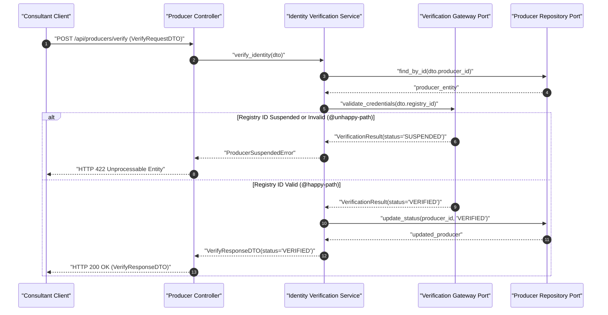
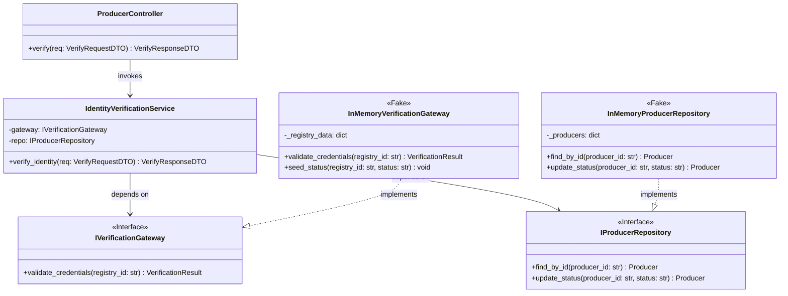

# Architectural Conception Example: Rural Producer Identity Verification

**Feature:** `producer-identity-verification`  
**Date:** 2026-10-26  
**Status:** Approved Phase 1 Specification (SDD 2.0)  
**Obsidian Note Links:** [[bdd-producer-identity-verification]] | [[sdd-producer-identity-verification]] | [[dod-producer-identity-verification]]  

---

## 1. Technical Goal & Desired End-State
- **Functional Outcome:** Enable technical consultants to securely verify rural producer identity credentials against national registry standards, generating an immutable audit trail without blocking offline workflows.
- **Business Value:** Prevents fraudulent producer onboarding, satisfies agricultural compliance regulations, and unlocks credit diagnosis workflows.
- **Success Criteria:** Sub-200ms validation latency for cached profiles, 100% deterministic offline fallback verification, zero plaintext credential storage.

---

## 2. Outcome-Based Debate & Scope Proposals

### Proposal 1: Pragmatic / Direct Synchronous Verification
- **Approach:** Direct REST call from API controller to National Registry endpoint upon submission.
- **Pros:** Lowest initial code volume; 1 day implementation.
- **Cons:** High coupling to 3rd-party latency; breaks when internet connectivity drops; no offline fallback.

### Proposal 2: Decoupled Clean Architecture with In-Memory Port (Selected & Approved)
- **Approach:** Domain service orchestrates verification through an abstract `IVerificationGateway` port. In-memory fake gateway for unit test isolation; local cached repository with eventual synchronization.
- **Pros:** Zero test flakiness, resilient offline fallback, Clean Architecture compliance, ready for asynchronous messaging.
- **Cons:** Requires port/adapter abstractions and DTO mappings (2 days implementation).

---

## 3. Sequential Implementation Plan

| # | Action | Rationale | Technical Acceptance Criteria | Dependency |
|---|---|---|---|---|
| 1 | Create verification gateway port & DTOs | Establish boundary contract | Types compile and test fakes implement interface | — |
| 2 | Implement verification domain service | Orchestrate business rules and caching | 100% unit test pass with in-memory double | Step 1 |
| 3 | Expose controller endpoint | REST API binding for consultant clients | Integration test verifies sub-200ms response | Step 2 |

---

## 4. Behavioral Specification (BDD Gherkin — `bdd-architect`)

```gherkin
Feature: Rural Producer Identity Verification
  In order to onboard producers securely and prevent regulatory fraud
  As a Technical Agricultural Consultant
  I want to verify producer registration data against national registry standards

  @happy-path
  Scenario: Successful verification with valid national registry ID
    Given no prior verification exists for registry ID "REG-12345"
    When the consultant submits valid producer identity credentials with ID "REG-12345"
    Then the verification status should be marked as "VERIFIED"
    And an immutable audit certificate should be issued
    And the producer profile should be unlocked for field diagnoses

  @unhappy-path @validation
  Scenario: Rejection of suspended or invalid registry ID
    Given the national registry marks ID "REG-99999" as "SUSPENDED"
    When the consultant attempts to verify identity using ID "REG-99999"
    Then the system should reject the verification request
    And the producer status should remain "UNVERIFIED"
    And an audit alert should be recorded with the suspension reason
```

---

## 5. Technical Architecture & Contracts (SDD — `sdd-architect`)

### 5.1. Technical Execution Flow (Sequence Diagram)



### 5.2. Component & Contract Structure (Class Diagram)



### 5.3. Typed Contracts (Pydantic)

```python
from pydantic import BaseModel, Field
from typing import Optional

class ProducerSuspendedError(Exception):
    """Raised when the national registry marks a producer ID as SUSPENDED."""

class VerifyRequestDTO(BaseModel):
    producer_id: str = Field(..., description="Internal producer UUID")
    registry_id: str = Field(..., min_length=5, max_length=20, description="National Registry ID")

class VerifyResponseDTO(BaseModel):
    producer_id: str = Field(..., description="Internal producer UUID")
    status: str = Field(..., description="Verification outcome: VERIFIED or REJECTED")
    certificate_id: Optional[str] = Field(None, description="Immutable audit certificate UUID")
```

### 5.4. Goldfish Council Blind Review & Arbitration Summary

| Persona (`Model: "flash"`) | Finding / Critique | Arbitration Verdict | Surgical Patch Applied |
| :--- | :--- | :---: | :--- |
| 🐠 `goldfish-yagni` | `ZERO_FINDINGS` — Port/Fake split is minimal and justified for offline resilience. | Approved | None required |
| 🐠 `goldfish-adversary` | Missing explicit domain exception for `@unhappy-path` suspended producer in `sequenceDiagram`. | Accepted | Added `ProducerSuspendedError` and `alt/else` branch |
| 🐠 `goldfish-implementer` | `InMemoryVerificationGateway` needed helper method to seed suspended IDs in unit tests. | Accepted | Added `+seed_status(registry_id: str, status: str) void` |

---

## 6. File Impact Analysis

| File Path | Change Type | Risk Level | Description & Rationale |
|---|---|---|---|
| `src/domain/verification.py` | Additive (New) | Low | Domain entity and value objects |
| `src/domain/ports/verification_gateway.py` | Additive (New) | Low | Gateway abstract interface |
| `src/services/identity_verification_service.py` | Additive (New) | Medium | Core verification orchestration logic |
| `src/adapters/in_memory_gateway.py` | Additive (New) | Low | In-memory test fake for TDD cycle |
| `src/api/producer_routes.py` | Mutative (Edit) | Medium | Expose verification endpoint |

---

## 7. Living Definition of Done (DoD) Setup

- [x] **Phase 1: Architecture & Conception (`/plan` — SDD 2.0)**
  - [x] Desired End-State aligned and Proposal 2 approved.
  - [x] Branch `feature/producer-identity-verification` validated.
  - [x] Context-Zero BDD scenarios documented in pure Gherkin syntax (`bdd-architect`).
  - [x] Context-Zero SDD Mermaid models and Pydantic contracts validated (`sdd-architect`).
  - [x] Parallel Goldfish Council review completed and arbitrated (`goldfish-yagni`, `goldfish-adversary`, `goldfish-implementer`).
  - [x] Semantic commit: `docs(conception): BDD, SDD, and DoD specifications for producer-identity-verification`.
- [ ] **Phase 2: Iterative TDD Implementation (`/implement`)**
- [ ] **Phase 3: Macro-Refactoring (`/refactor`)**
- [ ] **Phase 4: 5-Domain Audits (`/review`)**
- [ ] **Phase 5: Technical Documentation & Freeze (`/docs`)**
