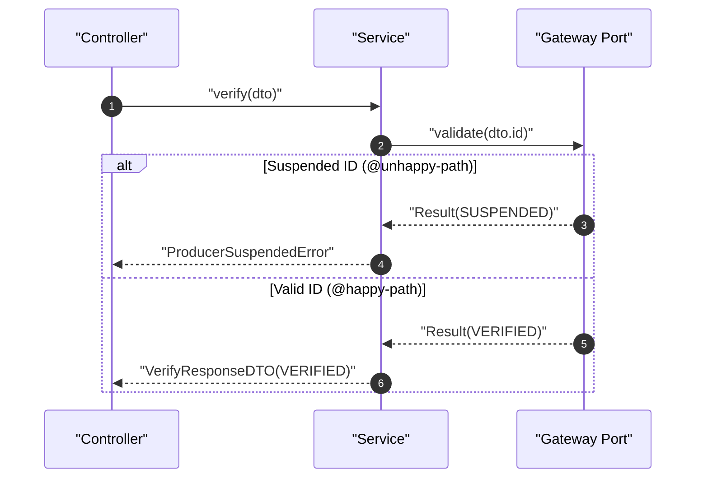

# Architectural Conception Walkthrough: Rural Producer Verification (`examples/plan-example.md`)

SDD 2.0 Phase 1 conception lifecycle for feature `producer-identity-verification`.

## 1. Lifecycle Trace & Decisions

| Phase / Gate | Decisions & Artifacts | Status |
| :--- | :--- | :--- |
| **Scope & Debate** | Goal: verify credentials against registry (< 200ms). Selected Proposal 2 (Clean Architecture with port + fake). | Approved |
| **Git & Branch** | Validated branch `feature/producer-identity-verification` via `validate_branch.py`. | Base locked |
| **BDD Modeling** | Pure Gherkin in `01-concepcao/bdd-producer-identity-verification.md` (`@happy-path`, `@unhappy-path`). Zero jargon. | Approved |
| **SDD Blueprint** | Modeled sequenceDiagram (`autonumber`, quoted, `alt/else`), classDiagram (`IVerificationGateway`, fake), DTOs, File Impact. | Valid exit `0` |
| **Goldfish Council** | `yagni`: ZERO_FINDINGS. `adversary`: added `ProducerSuspendedError`. `implementer`: added `+seed_status()`. | Patched |
| **Living DoD** | Initialized `dod-[slug].md` (1.1–1.6 `[x]`). Commit: `docs(conception): BDD, SDD, and DoD specifications for producer-identity-verification`. | Recorded |

## 2. Minimal Specification Artifacts

```gherkin
Feature: Rural Producer Verification
  @happy-path
  Scenario: Valid ID
    Given no prior verification for ID "REG-12345"
    When consultant submits valid credentials with ID "REG-12345"
    Then status is "VERIFIED" and certificate issued

  @unhappy-path @validation
  Scenario: Suspended ID
    Given registry marks ID "REG-99999" as "SUSPENDED"
    When consultant submits ID "REG-99999"
    Then system rejects and status remains "UNVERIFIED"
```



```python
class ProducerSuspendedError(Exception): pass
class VerifyRequestDTO(BaseModel):
    producer_id: str
    registry_id: str = Field(..., min_length=5, max_length=20)
class VerifyResponseDTO(BaseModel):
    producer_id: str
    status: str
```
