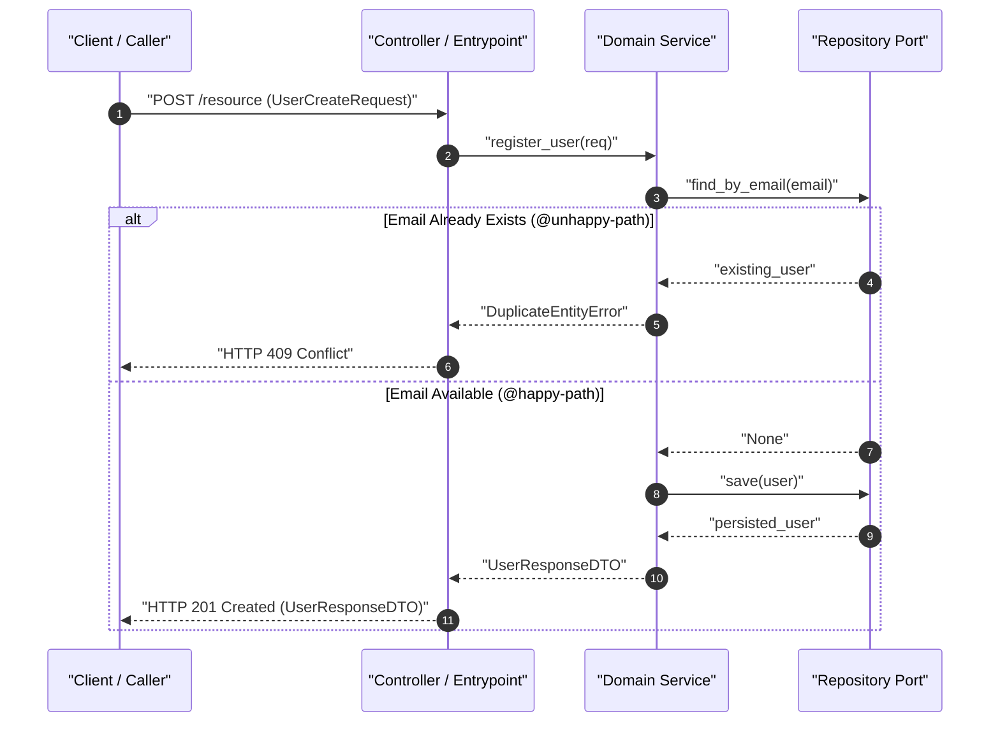
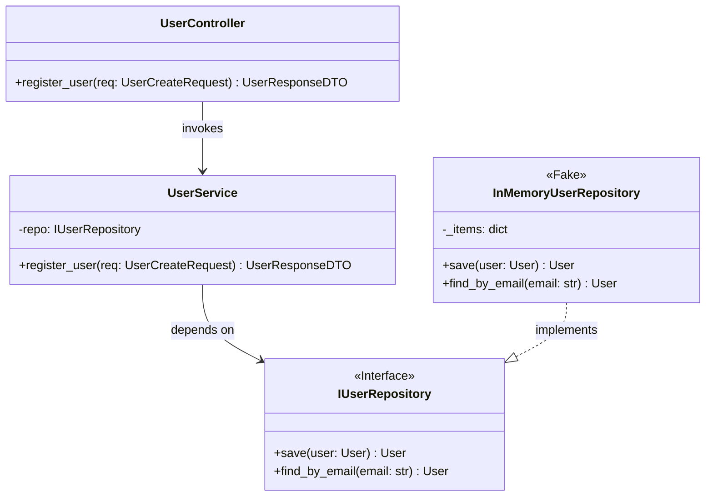

# Software Design Description Guide: Architecture & Contracts (`plan-sdd`)

This guide establishes the architectural standards for creating the Software Design Description (SDD 2.0) during Phase 1 (`/plan`), ensuring robust technical modeling before entering the Goldfish Council review and TDD implementation cycle.

---

## 1. Context-Zero Translation via `sdd-architect`

To verify that `01-concepcao/bdd-[slug].md` is self-contained and unambiguous:
- Step 4 is executed by the isolated `sdd-architect` subagent (`Model: "inherit"`, `EnableWriteTools: true`) as defined in [`references/plan-goldfish.md`](./plan-goldfish.md).
- `sdd-architect` has **zero access** to the Step 1 chat transcript; it derives the architecture strictly from `01-concepcao/bdd-[slug].md`, the approved proposal tier, and the codebase structure.

---

## 2. Clean Architecture & Dependency Inversion Principle (DIP)

Every technical design must adhere strictly to Clean Architecture boundaries:

```
[ Outer Layer: Controllers, CLI, HTTP Endpoints ]
                   │
                   ▼ (Invokes)
[ Domain Service / Use Case Interactor ]
                   │
                   ▼ (Depends on abstraction)
[ Domain Port Interface (<<Interface>>) ]
                   ▲
                   │ (Implements)
[ Infrastructure Adapter / In-Memory Fake (<<Fake>>) ]
```

- **Domain Isolation:** Entities, value objects, and domain services must have zero imports from external frameworks (no ORMs, no HTTP clients, no UI libraries).
- **Dependency Inversion:** High-level policy modules must never depend on low-level persistence or transport modules. Both depend on abstract Port interfaces.
- **Test Double First:** For every Port interface, specify an in-memory test double (`<<Fake>>` or `<<Mock>>`) enabling fast, deterministic AAA unit tests in Phase 2.

---

## 3. Mandatory Dual Visual Modeling & Semantic Parity (Mermaid.js)

Every SDD blueprint **MUST** contain both diagram models with **100% semantic method parity**:

### 3.1. Technical Execution Flow (`sequenceDiagram`)
- Traces execution across layers: `Caller -> Controller -> Domain Service -> Port -> Adapter/Fake`.
- **Mandatory Syntax & Semantic Rules:**
  - Must include `autonumber`.
  - All participant labels and message texts containing spaces, parentheses, or symbols **MUST be enclosed in double quotes** (`"..."`).
  - Must visualize both success flows and error branches (`alt / else`) corresponding to `@unhappy-path`, `@security`, and `@concurrency` scenarios in `01-concepcao/bdd-[slug].md`.
  - Every internal method call on a solid arrow (`->>` or `->`, e.g., `"register_user(req)"`, `"save(user)"`) **MUST match a declared method name in the `classDiagram`**.



### 3.2. Component & Contract Structure (`classDiagram`)
- Specifies class names, method signatures with typed arguments and returns, and relationships.
- Annotate Port interfaces with `<<Interface>>`.
- Annotate in-memory test doubles with `<<Fake>>` or `<<Mock>>`.



---

## 4. Typed Contracts & Boundary Schemas

Define typed request, response, and entity models using language-native schemas (e.g., Pydantic in Python or Zod in TypeScript):
- Map required fields, optional fields with defaults, and strict validation constraints.
- Define typed business exceptions (e.g., `DuplicateEntityError`, `EntityNotFoundError`) covering all negative BDD scenarios.
- Represent contracts in pure YAML using [`resources/sdd-contract-template.yaml`](../resources/sdd-contract-template.yaml).

---

## 5. File Impact Analysis Matrix

Before code changes are made in Phase 2, classify every anticipated file alteration:

| File Path | Change Type | Risk Level | Description & Rationale |
|---|---|---|---|
| `src/domain/entities.py` | Additive (New) | Low | Core business entity model |
| `src/domain/ports.py` | Additive (New) | Low | Persistence and notification abstract interfaces |
| `src/services/user_service.py` | Additive (New) | Medium | Business logic orchestration |
| `src/api/routes.py` | Mutative (Edit) | Medium | Mount new endpoint route |

---

## 6. Automated Syntax & Semantic Validation Gate

Validate the completed SDD artifact and its cross-artifact parity with the BDD specification using the validator script:
```bash
python skills/plan/scripts/validate_sdd_contracts.py 01-concepcao/sdd-[slug].md --bdd 01-concepcao/bdd-[slug].md
```
- **Validation Script:** [`scripts/validate_sdd_contracts.py`](../scripts/validate_sdd_contracts.py)
- **Contract Schema Template:** [`resources/sdd-contract-template.yaml`](../resources/sdd-contract-template.yaml)
- **Concrete Reference Example:** [`examples/plan-example.md`](../examples/plan-example.md)
