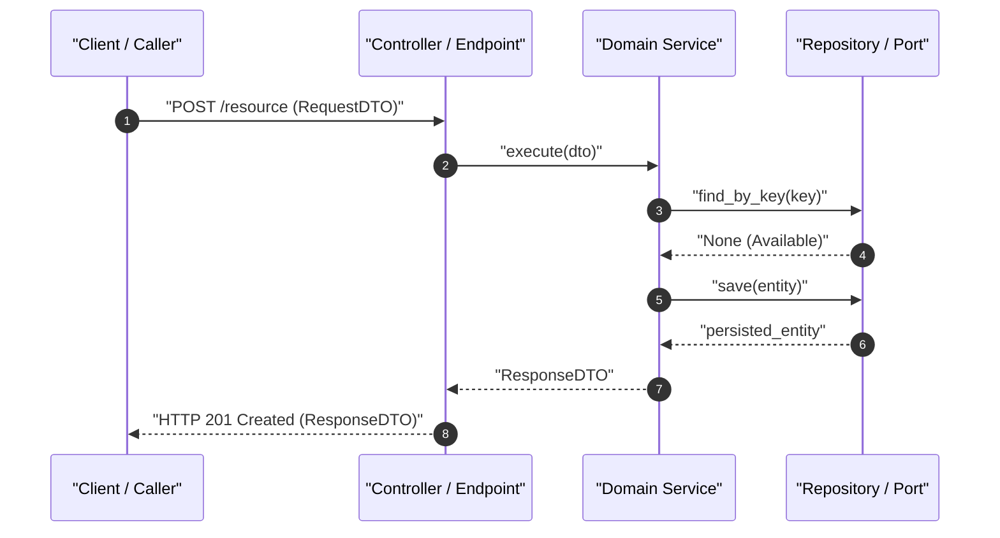
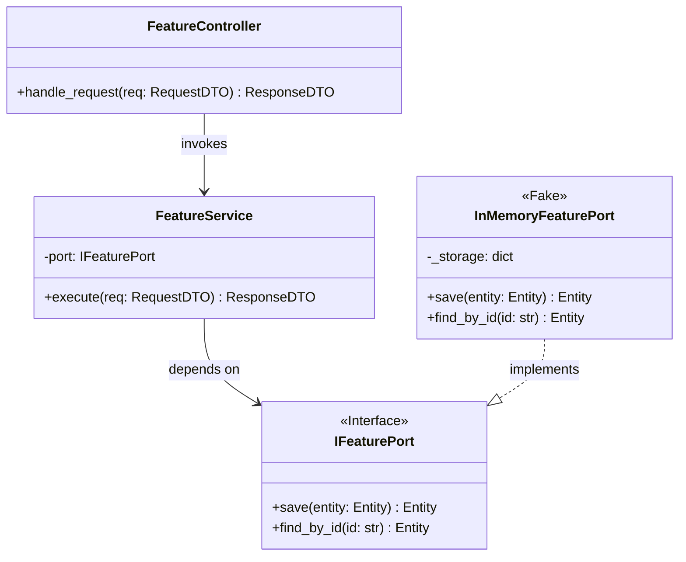

# Architectural Conception & Specification Plan: {{FEATURE_NAME}}

---

## 1. Technical Goal & Desired End-State
- **Functional Outcome:** {{FUNCTIONAL_OUTCOME}}
- **Business Value:** {{BUSINESS_VALUE}}
- **Measurable Success Criteria:** {{SUCCESS_CRITERIA}}

---

## 2. Scope Debate & Architectural Proposals

### Proposal 1: Pragmatic / Incremental
* **Approach:** {{P1_APPROACH}}
* **Advantages:** {{P1_PROS}}
* **Trade-offs:** {{P1_CONS}}
* **Estimated Impact:** {{P1_IMPACT}}

### Proposal 2: Architecturally Ideal / Scalable (Recommended)
* **Approach:** {{P2_APPROACH}}
* **Advantages:** {{P2_PROS}}
* **Trade-offs:** {{P2_CONS}}
* **Estimated Impact:** {{P2_IMPACT}}

### Selected Decision:
> **Approved Proposal:** {{SELECTED_PROPOSAL}}  
> **Rationale:** {{SELECTION_RATIONALE}}

---

## 3. Sequential Implementation Plan

| # | Action | Rationale | Technical Acceptance Criteria | Dependency |
|---|---|---|---|---|
| 1 | {{STEP_1_ACTION}} | {{STEP_1_RATIONALE}} | {{STEP_1_CRITERIA}} | — |
| 2 | {{STEP_2_ACTION}} | {{STEP_2_RATIONALE}} | {{STEP_2_CRITERIA}} | Step 1 |
| 3 | {{STEP_3_ACTION}} | {{STEP_3_RATIONALE}} | {{STEP_3_CRITERIA}} | Step 2 |

---

## 4. Behavioral Specification (BDD)

```gherkin
Feature: {{FEATURE_NAME}}
  In order to {{BUSINESS_VALUE}}
  As a {{USER_ROLE}}
  I want {{FUNCTIONAL_DESIRE}}

  @happy-path
  Scenario: Successful Happy Path Execution
    Given {{HAPPY_GIVEN}}
    When {{HAPPY_WHEN}}
    Then {{HAPPY_THEN}}
    And {{HAPPY_AND}}

  @unhappy-path @validation
  Scenario: Rejection of Invalid Request
    Given {{UNHAPPY_GIVEN}}
    When {{UNHAPPY_WHEN}}
    Then {{UNHAPPY_THEN}}
```

---

## 5. Architecture & Contracts (SDD)

### Technical Execution Flow (Sequence Diagram) [Mandatory]



### Component & Contract Structure (Class Diagram) [Mandatory]



### Typed Contracts & Boundary Mocks [Mandatory]

```python
# Language-native typed contracts (e.g., Pydantic)
from pydantic import BaseModel, Field

class RequestDTO(BaseModel):
    name: str = Field(..., min_length=2, description="Entity name")
    identifier: str = Field(..., description="Unique business identifier")

class ResponseDTO(BaseModel):
    id: str = Field(..., description="Generated UUID")
    status: str = Field(default="active", description="Status code")
```

---

## 6. Requirements & Architectural Traceability Matrix (RTM)

> **Traceability Standard:** Aligned with IEEE 829 and ISO/IEC/IEEE 29119 (Requirements Traceability Matrix).

| BDD Scenario / User Requirement | SDD Contract / Component | Impacted Source Files | Living DoD Acceptance Gate | Traceability Status |
| :--- | :--- | :--- | :--- | :---: |
| `@happy-path` (Scenario 1) | `FeatureController.handle_request` | `src/api/routes.py` | 100% Green Unit Tests | 🟢 **Mapped** |
| `@unhappy-path` (Scenario 2) | `RequestDTO.identifier` validation | `src/domain/entities.py` | HTTP 422 Rejection Test | 🟢 **Mapped** |
| Boundary Integration | `IFeaturePort.save` / Adapter | `src/infra/repo.py` | Contract Test with Fake/Mock | 🟡 **Attention** ([see Architectural Point 1](#-architectural-point-1)) |

### Architectural Points of Attention & Trade-Offs

#### 📌 Architectural Point 1: [Critical Integration / Trade-off Description]
* **Target Interface / Component:** `[path/to/component.py]`
* **Identified Risk / Tension:** [e.g., Latency impact, external dependency availability, strict boundary isolation]
* **Mitigation Strategy:** [e.g., Asynchronous worker, fallback cache, interface inversion via Port]
* **Verification Criteria:** [How the automated test suite will prove this point is resolved]

---

## 7. File Impact Analysis

| File / Module | Change Type | Risk Level | Description & Rationale |
|---|---|---|---|
| `src/domain/entities.py` | Additive (New) | Low | Domain entity definition |
| `src/domain/ports.py` | Additive (New) | Low | Interface port abstractions |
| `src/services/feature_service.py` | Additive (New) | Medium | Core business logic |
| `src/api/routes.py` | Mutative (Edit) | Medium | Add controller route mapping |

---

## 8. Living Definition of Done (DoD) Setup

- [x] Phase 1: Architectural Conception & Planning completed
- [ ] Phase 2: Iterative TDD Implementation (`/implement`)
- [ ] Phase 3: Macro-Refactoring across diff (`/refactor`)
- [ ] Phase 4: Specialized 5-Domain Audits (`/review`)
- [ ] Phase 5: Documentation & Feature Freeze (`/docs`)
