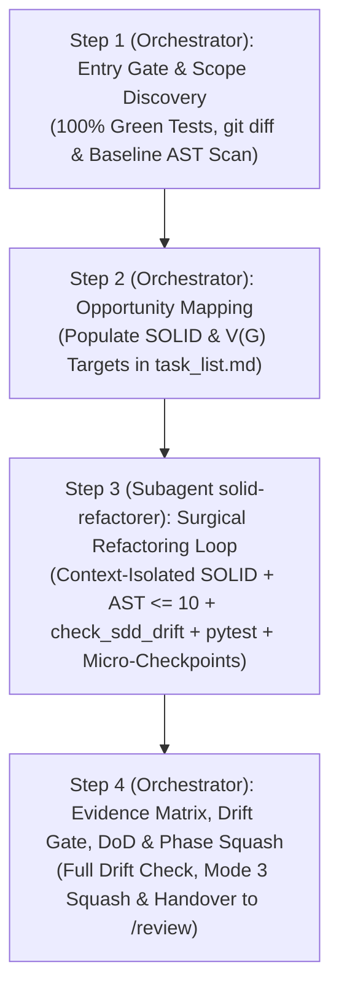

# Skill: Consolidation Macro-Refactoring (`/refactor` — SDD 2.0)

Orchestrates Phase 3 of the feature development lifecycle under the **SDD 2.0 (Elephant & Goldfish)** model, consolidating architectural design across the complete feature changeset (`git diff develop...HEAD`) via a context-isolated **`solid-refactorer` subagent** while keeping the test suite 100% green, enforcing AST cyclomatic complexity ($V(G) \le 10$), and guaranteeing zero public contract drift via `check_sdd_drift.py`.

---

## Operational Scope & Invariant Rules

- **Execution Context:** Operates after all functional TDD batches in `/implement` are complete.
- **Scope Boundary:** Restricted strictly to files modified on the active feature branch (`git --no-pager diff develop...HEAD --name-only`). Untouched legacy code is out of scope.
- **Macro vs. Micro Boundary:** Micro-refactoring of individual classes was completed during the Blue Phase of `/implement`. `/refactor` addresses systemic, cross-module SOLID compliance, interface segregation, dependency inversion, and algorithmic efficiency.
- **Invariant Safety Rules:**
  1. **Mandatory Entry Gate:** 100% of the unit test suite must pass green before inspecting or modifying any code. If tests fail, abort immediately and redirect the user to `/implement` or `/test-fix`.
  2. **Strict Behavioral & SDD Contract Preservation:** Refactoring must never alter public SDD contracts, API signatures, observable behavior, or return types, verified deterministically via [`../implement/scripts/check_sdd_drift.py`](../implement/scripts/check_sdd_drift.py).
  3. **Zero Test Assertion Modifications:** Production code is refactored; test assertions are **never** weakened or changed to accommodate refactored code.
  4. **AST Complexity Enforcement:** Every modified function must satisfy McCabe cyclomatic complexity $V(G) \le 10$ via [`./scripts/ast_complexity.py`](./scripts/ast_complexity.py).
  5. **Zero Test Regressions & Rollback:** Run the test suite after every single transformation inside `solid-refactorer`. If any test fails, revert immediately via `git reset --hard HEAD` (Mode 4).

---

## Execution Pipeline in 4 Steps (Orchestrator + `solid-refactorer` Subagent)



### Step 1: Entry Gate & Scope Discovery *(Main Orchestrator)*
1. **Execute Unit Test Suite:** Run the full test suite in the terminal:
   ```bash
   python -m pytest tests/unit/ -v
   ```
   *Gate Lock:* If any test fails, abort refactoring immediately. Direct the user: *"Unit tests are failing. Resolve regressions in `/implement` or `/test-fix` before beginning refactoring."*
2. **Discover Modified Scope:** Identify files modified in this feature branch:
   ```bash
   git --no-pager diff develop...HEAD --name-only
   ```
   *(Fallback to `main...HEAD` if `develop` does not exist)*.
3. **Execute Baseline AST Complexity & SDD Drift Scan:**
   ```bash
   python skills/refactor/scripts/ast_complexity.py <MODIFIED_PYTHON_FILES> --threshold 10
   python skills/implement/scripts/check_sdd_drift.py 01-concepcao/sdd-[slug].md <MODIFIED_PYTHON_FILES> --check-files --pivots 02-auditorias/pivots-[slug].md
   ```
   Record any functions exceeding $V(G) > 10$ or triggering nested loop warnings.

### Step 2: Opportunity Mapping in `task_list.md` *(Main Orchestrator)*
1. Inspect the modified files against the catalog in [`./references/solid-catalog.md`](./references/solid-catalog.md):
   - **AST Complexity:** Functions with $V(G) > 10$, deep conditional nesting, or multi-branch logic.
   - **Single Responsibility (SRP):** Functions exceeding 20–25 lines, classes mixing domain logic with I/O or formatting.
   - **Dependency Inversion (DIP):** Direct instantiation of external clients, repositories, or services within business use cases.
   - **Clean Code Smells:** Magic numbers, string literals, duplicate expressions, unclear parameter names.
   - **Asymptotic Inefficiencies:** $O(N^2)$ nested loops or linear membership tests (`in list`) inside iterations.
2. Initialize or populate the refactoring backlog in `task_list.md`:
   ```markdown
   - [ ] **Target:** `src/services/order_service.py::OrderService.process_order`
     - **Smell / Violation:** Deep nesting, high complexity (V(G)=14), magic numbers
     - **Planned Action:** Guard clauses, named constants, extract private helpers
     - **Status:** Planned [ ]
   ```

### Step 3: Context-Isolated Surgical Refactoring Loop *(Subagent `solid-refactorer`)*
Define and invoke the **`solid-refactorer`** subagent (`EnableWriteTools: true`, `Model: "inherit"`) following [`./references/refactor-subagents.md`](./references/refactor-subagents.md) so repetitive `pytest` runs and intermediate diffs do not pollute the main conversation context window.

For each refactoring target in `task_list.md`, `solid-refactorer` executes:
1. **Apply Targeted Transformation:** Apply Clean Code and SOLID patterns as guided by [`./references/solid-catalog.md`](./references/solid-catalog.md).
2. **Re-scan AST Complexity & SDD Drift Gate:**
   ```bash
   python skills/refactor/scripts/ast_complexity.py <MODIFIED_FILE> --threshold 10
   python skills/implement/scripts/check_sdd_drift.py 01-concepcao/sdd-[slug].md <MODIFIED_FILE> --batch --pivots 02-auditorias/pivots-[slug].md
   ```
   Confirm $V(G) \le 10$, zero asymptotic warnings, and zero public SDD contract drift.
3. **Run Regression Tests:**
   ```bash
   python -m pytest tests/unit/ -v
   ```
4. **Evaluate Test Outcome:**
   - **Failure:** Revert immediately via [`./references/refactor-git.md`](./references/refactor-git.md) (Mode 4: `git reset --hard HEAD`). Never alter tests. If 2 consecutive attempts fail, apply the Double-Strike Rule: retain the working green implementation, log the rationale, and proceed.
   - **Success (100% Green):** Record a local micro-checkpoint via [`./references/refactor-git.md`](./references/refactor-git.md) (Mode 2):
     ```bash
     git add <MODIFIED_FILES>
     git commit -m "checkpoint(refactor): [target] - [action applied]"
     ```
5. Mark the task item complete (`[x]`) in `task_list.md` and return the completed Refactoring Evidence Matrix to the Main Orchestrator.

### Step 4: Refactoring Evidence Matrix, DoD Update & Phase Squash *(Main Orchestrator)*
1. **Verify Full Exit Gates:** Confirm `ast_complexity.py`, `check_sdd_drift.py`, and `pytest tests/unit/ -v` pass with exit code 0 across all modified feature files.
2. **Present Refactoring Evidence Matrix:** Present the before/after change matrix returned by `solid-refactorer` conforming to [`./resources/refactor-report-template.md`](./resources/refactor-report-template.md) and [`./references/refactor-dod.md`](./references/refactor-dod.md):
   ```markdown
   | Target File & Function | Code Smell / SOLID Violation | Transformation Applied | V(G) Before | V(G) After | Tests & SDD Drift |
   | :--- | :--- | :--- | :--- | :--- | :--- |
   | `order_service.py:process_order` | Deep Nesting & High Complexity | Guard Clauses & Extract Helpers | 14 | 3 | 100% Green / 0 Drift |
   | `order_service.py:calculate_tax` | Magic Numbers | Named Constants (`TAX_RATE_STANDARD`) | 4 | 2 | 100% Green / 0 Drift |
   ```
3. **Update Living DoD:** Mark Phase 3 complete in `01-concepcao/dod-[slug].md` as specified in [`./references/refactor-dod.md`](./references/refactor-dod.md):
   ```markdown
   - [x] Phase 3: Final Refactoring (/refactor)
   ```
4. **Consolidate Checkpoints via Phase Squash (Mode 3):** Follow [`./references/refactor-git.md`](./references/refactor-git.md) to squash intermediate checkpoints into a structured semantic commit:
   ```bash
   git reset --soft <PHASE_START_HASH>
   git commit -m "refactor(consolidation): apply Clean Code and SOLID for [slug]"
   ```
5. **Issue Handover Recommendation:** Output the mandatory phase transition prompt:
   > **[NEXT STEP]** *"Phase 3 (Macro-Refactoring — SDD 2.0) completed with 100% green tests, zero SDD Drift, and AST complexity V(G) <= 10 across all feature files! Open a **NEW CHAT** and run `/review` to begin specialized 5-domain parallel code audits."*

---

## Supporting References & Tooling Index

- **Pure Templates:**
  - [`resources/refactor-report-template.md`](./resources/refactor-report-template.md) — Standardized refactoring consolidation report with Executive Summary, Complexity Matrix, Detailed Transformations, and Handover.
- **Operational Guides:**
  - [`references/refactor-subagents.md`](./references/refactor-subagents.md) — Context-isolated `solid-refactorer` subagent protocol and SDD 2.0 Drift Gate enforcement.
  - [`references/solid-catalog.md`](./references/solid-catalog.md) — SOLID patterns, Clean Code transformations, and AST complexity reduction guide.
  - [`references/refactor-git.md`](./references/refactor-git.md) — Git Flow operational modes: scope discovery, micro-checkpoints, zero-regression rollback, and Phase Squash.
  - [`references/refactor-dod.md`](./references/refactor-dod.md) — Definition of Done checklist for Phase 3 and Refactoring Evidence Matrix standards.
- **Executable Multiplatform Tooling:**
  - [`scripts/ast_complexity.py`](./scripts/ast_complexity.py) — Python CLI AST scanner for cyclomatic complexity $V(G) \le 10$ and Big-O performance heuristics.
  - [`../implement/scripts/check_sdd_drift.py`](../implement/scripts/check_sdd_drift.py) — SDD 2.0 AST/Contract Drift Gate validator.
- **Concrete Example:**
  - [`examples/refactor-example.md`](./examples/refactor-example.md) — Representative end-to-end refactoring demonstration from smelly code to clean SOLID architecture.
