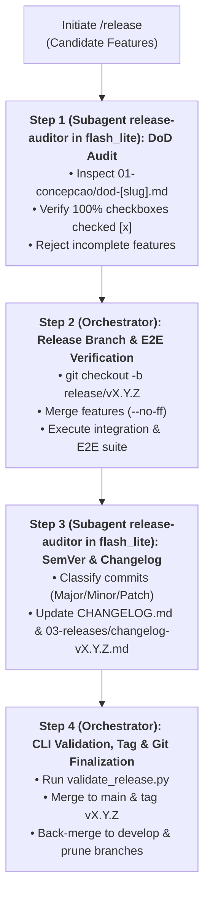

# Skill: Production Release & Git Flow Finalization (`/release` — SDD 2.0)

Orchestrates the formal publication of new system releases under the **SDD 2.0 (Elephant & Goldfish)** model, delegating Living DoD 100% checkbox auditing and SemVer 2.0.0 changelog generation to a fast **`release-auditor` subagent (`Model: "flash_lite"`)**, while the Main Orchestrator verifies end-to-end integration test suites, runs `validate_release.py`, and executes atomic Git Flow Mode 5 finalization.

---

## Operational Scope & Invariant Guardrails

- **Execution Context:** Activated when one or more candidate feature branches (`feature/[slug]`) have completed all lifecycle phases (Phases 1 through 5) and are ready for official release bundling.
- **Invariant Safety Guardrails:**
  1. **Strict 100% Living DoD Entry Gate (`release-auditor`):** Every candidate feature must possess an approved Living DoD log (`01-concepcao/dod-[slug].md`). If a single unchecked box (`- [ ]`) exists across any candidate feature, the release is immediately aborted and rejected.
  2. **End-to-End Integration Gate:** All integration test suites (`pytest tests/integration/`) must pass 100% green on the release branch before tagging. Regressions discovered during integration must be resolved with surgical commits on the release branch.
  3. **Rigorous SemVer 2.0.0 Enforcement (`release-auditor`):** Version bumps are determined strictly by analyzing commit semantics and public API contract preservation (Major for breaking changes, Minor for backward-compatible features, Patch for fixes).
  4. **Dual Changelog Synchronization:** Every release must update both the project root `CHANGELOG.md` and persist an immutable release snapshot in the Obsidian Vault (`03-releases/changelog-v[VERSION].md`).
  5. **Atomic Git Flow Mode 5 Finalization:** The release branch is merged into `main` using `--no-ff`, tagged with an annotated cryptographic tag (`git tag -a v[VERSION]`), back-merged into `develop`, and pruned cleanly.

---

## Execution Pipeline in 4 Steps (Orchestrator + `release-auditor` in `Model: "flash_lite"`)



### Step 1: Entry Gate Audit & Feature Scope Resolution *(Subagent `release-auditor` — `Model: "flash_lite"`)*

1. Identify candidate feature branches supplied for the release bundle (e.g., `feature/auth-jwt`, `feature/payment-webhook`).
2. Define and invoke the **`release-auditor`** subagent (`Model: "flash_lite"`) following [`./references/release-subagents.md`](./references/release-subagents.md) to conduct an isolated audit of all Living DoD files:
   - For each feature, inspect `01-concepcao/dod-[slug].md`.
   - Ensure all five phase sections (Planning, Implementation, Refactoring, Review, Documentation) are fully signed off.
   - Verify that **zero** unchecked items (`- [ ]`) remain in any DoD file.
3. *Phase Gate Action:* If `release-auditor` reports any unchecked item, emit an immediate rejection alert detailing the incomplete feature and abort the release workflow.
4. Consult [`./references/release-checklist.md`](./references/release-checklist.md) for full gate criteria.

### Step 2: Release Branch Creation & Integration / E2E Verification *(Main Orchestrator)*

1. Ensure the local workspace is on `develop` with a clean working tree:
   ```bash
   git checkout develop
   git pull origin develop
   ```
2. Create the dedicated release branch with the provisional version:
   ```bash
   git checkout -b release/v[VERSION_PREVIEW]
   ```
3. Merge each approved candidate feature branch without fast-forward:
   ```bash
   git merge --no-ff feature/[slug-1] -m "merge: feature/[slug-1] into release"
   git merge --no-ff feature/[slug-2] -m "merge: feature/[slug-2] into release"
   ```
4. Execute the comprehensive integration and E2E test suite:
   ```bash
   python -m pytest tests/integration/ -v
   ```
5. If inter-feature integration defects arise, implement surgical fixes directly on the release branch and re-verify until 100% of the suite passes green.

### Step 3: SemVer 2.0.0 Calculation & Changelog Synchronization *(Subagent `release-auditor` — `Model: "flash_lite"`)*

1. Message or invoke `release-auditor` (`Model: "flash_lite"`, `EnableWriteTools: true`) with the merged commit log (`git --no-pager log develop..HEAD --oneline`) to:
   - Analyze commit headers against SemVer 2.0.0 guidelines:
     - Contains `BREAKING CHANGE:` or `feat!:` / `fix!:` $\rightarrow$ **MAJOR** bump (`v(X+1).0.0`).
     - Contains backward-compatible `feat:` $\rightarrow$ **MINOR** bump (`vX.(Y+1).0`).
     - Contains only `fix:`, `perf:`, `refactor:`, `docs:`, or `chore:` $\rightarrow$ **PATCH** bump (`vX.Y.(Z+1)`).
   - Instantiate [`./resources/release-template.md`](./resources/release-template.md) and consolidate deliverables into categorized release notes (`Added`, `Changed`, `Fixed`, `Security`, `Breaking Changes`).
   - Prepend the new release block to `CHANGELOG.md` at repository root and save a persistent copy to `03-releases/changelog-v[VERSION].md` in the Obsidian Vault.

### Step 4: CLI Validation, Tagging & Git Flow Finalization *(Main Orchestrator)*

1. Execute the multiplatform release validation utility to verify version formatting, changelog presence, and DoD completeness:
   ```bash
   python skills/release/scripts/validate_release.py --version v[VERSION] --branch release/v[VERSION] --changelog CHANGELOG.md --check-dod "01-concepcao/dod-*.md"
   ```
2. Commit release preparations on the release branch:
   ```bash
   git add CHANGELOG.md 03-releases/
   git commit -m "chore(release): prepare release v[VERSION]"
   ```
3. Finalize Git Flow Mode 5 release merges:
   ```bash
   # Merge release branch into main
   git checkout main
   git merge --no-ff release/v[VERSION] -m "release: v[VERSION]"

   # Create cryptographic annotated tag
   git tag -a v[VERSION] -m "Release v[VERSION]"

   # Back-merge release into develop
   git checkout develop
   git merge --no-ff release/v[VERSION] -m "merge: sync release v[VERSION] back to develop"

   # Delete temporary release branch and merged feature branches
   git branch -d release/v[VERSION]
   git branch -d feature/[slug-1]
   git branch -d feature/[slug-2]
   ```
4. Emit the release completion notification:
   > **[RELEASE COMPLETED]** *"Version `v[VERSION]` published successfully with 100% DoD verified, integration tests passed, annotated tag created, and branches merged into `main` and `develop`!"*

---

## Bundled References, Resources, Scripts & Examples

- **Operational Checklist, Subagents & SemVer Rules:**
  - [`references/release-subagents.md`](./references/release-subagents.md) — `release-auditor` (`Model: "flash_lite"`) orchestration for 100% DoD gatekeeping and SemVer changelog compilation.
  - [`references/release-checklist.md`](./references/release-checklist.md) — Comprehensive readiness gate criteria, SemVer 2.0.0 decision matrix, and DoD audit rules.
- **Unpopulated Release Template:**
  - [`resources/release-template.md`](./resources/release-template.md) — Standardized release notes and changelog markdown template.
- **Multiplatform CLI Utility:**
  - [`scripts/validate_release.py`](./scripts/validate_release.py) — Cross-platform Python validator for SemVer strings, release branches, changelog presence, and DoD completeness.
- **Concrete Walkthrough Example:**
  - [`examples/release-example.md`](./examples/release-example.md) — Step-by-step release walkthrough featuring candidate features, DoD verification, and Git Flow finalization.
