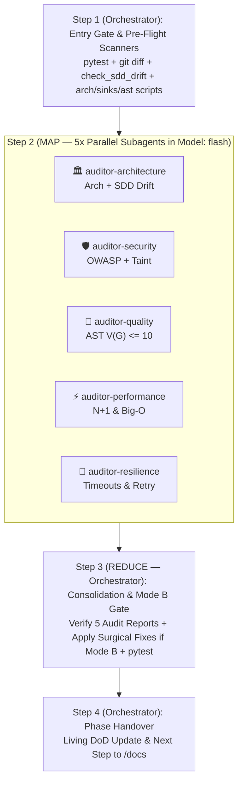

# Skill: Specialized Multi-Domain Code Review (`/review` — SDD 2.0 Map-Reduce)

Orchestrates the specialized audit phase of the feature development lifecycle under the **SDD 2.0 Map-Reduce** architecture, running deterministic pre-flight scanners (including the **SDD Drift Gate**) followed by **5 parallel context-isolated domain subagents** (`Model: "flash"`) across all changes introduced in the feature branch.

---

## Operating Modes

1. **Mode A — Audit-Only (Default):**
   - Runs pre-flight CLI scanners (`check_sdd_drift.py`, `check_arch_boundaries.py`, `scan_sinks.py`, `ast_complexity.py`).
   - Dispatches 5 parallel `Model: "flash"` domain subagents to inspect the diff and Call Hierarchy (1–2 levels outside diff).
   - Generates 5 standardized domain audit reports in `02-auditorias/audit-[domain]-[slug].md` conforming to [`./resources/audit-report-template.md`](./resources/audit-report-template.md).
   - Updates the Living Definition of Done in `01-concepcao/dod-[slug].md`.
   - **STRICT RULE:** Do NOT modify source code files. Do NOT execute `git commit` or `git add`.

2. **Mode B — Authorized Surgical Remediation (`/review --fix`):**
   - Triggered ONLY when explicitly invoked with `--fix` or authorized by the user.
   - Executes the same parallel Map phase (5 subagents generate the 5 audit reports without touching source code to avoid file write race conditions).
   - In the Reduce phase (Step 3), the **Main Orchestrator** consolidates all findings across the 5 reports and applies minimal, surgical fixes strictly to the flagged lines/vulnerabilities.
   - Re-runs unit/integration tests and scanners to ensure 100% green integrity.
   - Stages **strictly the modified files** (`git add <file1> <file2>`). **NEVER run `git add .`** to avoid capturing unintended working tree changes.
   - Records micro-checkpoints: `checkpoint(review): fixes for [domain]`.

---

## Operational Scope & Boundaries

- **Entry Gate:** Execute the full test suite in the terminal. All tests must be passing green before beginning any audit.
- **Diff-Based Scope:** Retrieve strictly the modified files and unified diff on this branch against the base branch (default: `develop` or target PR branch):
  ```bash
  git --no-pager diff develop...HEAD --name-only
  git --no-pager diff develop...HEAD --unified=3
  ```
- **Scope Exclusions:** Exclude autogenerated files, lockfiles (`poetry.lock`, `package-lock.json`), and compiled binaries.
- **Call Hierarchy & Taint Analysis Authorization:**
  - The feature diff is your primary scope.
  - Whenever a modified line receives untrusted external inputs (HTTP/gRPC/CLI), handles authentication or authorization, or passes data to external sinks/APIs/databases, you have **explicit authorization to inspect the Call Hierarchy (1 to 2 levels up caller, 1 to 2 levels down callee)** outside the diff to trace taint flow, input sanitization, and authorization.

---

## Execution Pipeline in 4 Steps (Map-Reduce Multi-Agent)



### Step 1: Entry Gate, Diff Scope & Pre-Flight Scanners *(Main Orchestrator)*
1. Run existing test suite in terminal:
   ```bash
   python -m pytest -v
   ```
   If any test fails, abort the review immediately and direct the user to resolve failures first.
2. Retrieve the base branch, current commit SHA, and changed file list:
   ```bash
   git --no-pager diff develop...HEAD --name-only
   ```
3. Run the **4 deterministic CLI scanners** across the modified files to collect baseline evidence for the subagents:
   ```bash
   python skills/implement/scripts/check_sdd_drift.py 01-concepcao/sdd-[slug].md <modified_files> --check-files --pivots 02-auditorias/pivots-[slug].md
   python skills/review/scripts/check_arch_boundaries.py <modified_files>
   python skills/review/scripts/scan_sinks.py <modified_files>
   python skills/review/scripts/ast_complexity.py <modified_files>
   ```
4. Document eligible files, excluded files, scanner outputs, and git metadata for the subagents.

#### Script-First Principle (Priority, Not Scope Boundary):
- Scanners run first to **prioritize initial reading and catch known anti-patterns fast**.
- Automated scripts do **NOT** define the boundary of your review. Subagents must inspect all relevant changes in the diff, business logic, authorization, and design boundaries even if not flagged by a script.
- If a script encounters language limitations or unsupported files, record the limitation explicitly. **Never interpret script errors or empty outputs as an automatic clean pass.**

---

### Step 2: Parallel 5-Domain Map Audit *(5x `Model: "flash"` Subagents)*

Following [`./references/review-subagents.md`](./references/review-subagents.md), define and invoke all **5 domain subagents in parallel in a single turn** (`Model: "flash"`, `EnableWriteTools: true` strictly for writing `02-auditorias/audit-[domain]-[slug].md`; subagents NEVER touch `src/` or `tests/`):

#### 2.1. Domain 1: Architecture, Boundary Isolation & SDD Drift (`auditor-architecture`)
1. **Scanner Inputs:** Outputs of [`scripts/check_arch_boundaries.py`](./scripts/check_arch_boundaries.py) and [`../implement/scripts/check_sdd_drift.py`](../implement/scripts/check_sdd_drift.py).
2. **Inspect Code:** Evaluate layer boundaries, Dependency Inversion (DIP), DTO encapsulation, God Class decomposition, and unauthorized SDD Contract Drift against `01-concepcao/sdd-[slug].md`.
3. **Reference Guide:** [`references/review-architecture.md`](./references/review-architecture.md)
4. **Report Output:** Write findings to `02-auditorias/audit-architecture-[slug].md`.

#### 2.2. Domain 2: OWASP Security & Dangerous Sinks (`auditor-security`)
1. **Scanner Input:** Output of [`scripts/scan_sinks.py`](./scripts/scan_sinks.py).
2. **Inspect Code:** Trace dangerous sinks (`eval`, `exec`, `subprocess`, SQL interpolation), perform taint analysis on user inputs (1–2 levels Call Hierarchy), verify server-side ownership (IDOR/BPOA), TOCTOU concurrency, PII masking (`***REDACTED***`), and secret management.
3. **Reference Guide:** [`references/review-security.md`](./references/review-security.md)
4. **Report Output:** Write findings to `02-auditorias/audit-security-[slug].md`.

#### 2.3. Domain 3: Code Quality & AST Complexity (`auditor-quality`)
1. **Scanner Input:** Output of [`scripts/ast_complexity.py`](./scripts/ast_complexity.py).
2. **Inspect Code:** Ensure cyclomatic complexity $V(G) \le 10$ per function/method. Check for nested loops ($O(N^2)$), linear searches in loops, deep pyramid nesting (> 3 levels), and absence of guard clauses.
3. **Reference Guide:** [`references/review-quality.md`](./references/review-quality.md)
4. **Report Output:** Write findings to `02-auditorias/audit-quality-[slug].md`.

#### 2.4. Domain 4: Performance & Resource Efficiency (`auditor-performance`)
1. **Inspect Code:** Analyze operational context (workload scale, QPS, latency SLAs). Check for N+1 queries in loops, quadratic algorithms, unbounded memory reads, unbuffered I/O, and connection leaks.
2. **Reference Guide:** [`references/review-performance.md`](./references/review-performance.md)
3. **Report Output:** Write findings to `02-auditorias/audit-performance-[slug].md`.

#### 2.5. Domain 5: Resilience & Fault Tolerance (`auditor-resilience`)
1. **Inspect Code:** Verify explicit connect and read timeouts on all network calls (HTTP, gRPC, DB, queues). Enforce the **Golden Rule of Idempotency** (never retry non-idempotent operations without an idempotency key). Verify exponential backoff with jitter, circuit breakers, and fail-secure fallbacks.
2. **Reference Guide:** [`references/review-resilience.md`](./references/review-resilience.md)
3. **Report Output:** Write findings to `02-auditorias/audit-resilience-[slug].md`.

---

### Step 3: Reduce Consolidation, Mode B Remediation & Integrity Gate *(Main Orchestrator)*

1. **Verify All 5 Reports & Living DoD:**
   - Ensure all 5 domain audit reports exist under `02-auditorias/audit-[domain]-[slug].md`.
   - Check off all 5 audit checkboxes in `01-concepcao/dod-[slug].md`.
2. **Mode B Surgical Remediation (`--fix` Only):**
   - Consolidate findings across the 5 reports and apply minimal, conflict-free surgical fixes to the source files (`src/`).
   - Stage strictly modified files (`git add <file1> <file2>`) and record domain micro-checkpoints (`checkpoint(review): fixes for [domain]`).
   - Re-run the CLI scanners (`check_sdd_drift.py`, `check_arch_boundaries.py`, `scan_sinks.py`, `ast_complexity.py`) to confirm clearance.
3. **Full Test Suite Integrity Check:**
   - Re-execute the complete unit and integration test suite:
     ```bash
     python -m pytest -v
     ```
   - Record exact metrics: Total Executed, Passed, Failed, Skipped.

---

### Step 4: Phase 4 Conclusion & Handover *(Main Orchestrator)*

1. In **Mode B**, execute a semantic phase consolidation commit:
   ```bash
   git commit -m "audit(review): specialized domain audits completed for [slug]"
   ```
2. Output the mandatory phase transition handover recommendation:
   > **[NEXT STEP]** *"Phase 4 (Audits — SDD 2.0) completed across all 5 parallel domains with zero SDD Drift! Review findings documented in audit reports under `02-auditorias/`. Open a **NEW CHAT** and run `/docs` to finalize technical feature documentation."*

---

## Package Index & References

- **Operational Guides:**
  - [`references/review-subagents.md`](./references/review-subagents.md) — 5-domain parallel `Model: "flash"` Map-Reduce orchestration and Mode B conflict-free consolidation.
  - [`references/review-architecture.md`](./references/review-architecture.md) — Layer boundary rules, DIP, DTO isolation, God Class decomposition, and SDD Drift Gate.
  - [`references/review-security.md`](./references/review-security.md) — OWASP Top 10, ASVS, dangerous sinks, taint analysis, secret containment.
  - [`references/review-quality.md`](./references/review-quality.md) — AST complexity $V(G) \le 10$, cognitive load, Clean Code standards.
  - [`references/review-performance.md`](./references/review-performance.md) — N+1 query patterns, algorithmic bottlenecks, memory streaming.
  - [`references/review-resilience.md`](./references/review-resilience.md) — Mandatory timeouts, idempotent retries, circuit breakers, fail-secure fallbacks.
- **Pure Templates:**
  - [`resources/audit-report-template.md`](./resources/audit-report-template.md) — Standardized audit report template with Executive Summary, Traceability Matrix, Forensic Findings, and Action Plan.
- **Automated CLI Scanners:**
  - [`../implement/scripts/check_sdd_drift.py`](../implement/scripts/check_sdd_drift.py) — SDD 2.0 AST/Contract Drift Gate validator.
  - [`scripts/check_arch_boundaries.py`](./scripts/check_arch_boundaries.py) — Clean Architecture layer boundary linter.
  - [`scripts/scan_sinks.py`](./scripts/scan_sinks.py) — OWASP v2 dangerous sinks & code crawler.
  - [`scripts/ast_complexity.py`](./scripts/ast_complexity.py) — Python AST McCabe cyclomatic complexity scanner.
- **Representative Example:**
  - [`examples/review-example.md`](./examples/review-example.md) — Real-world 5-domain audit walkthrough and report output.
