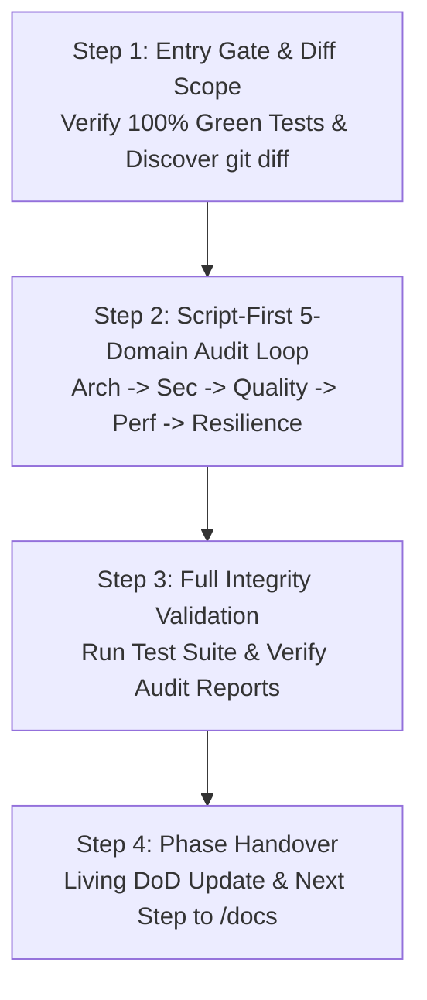
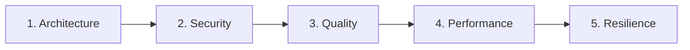

# Skill: Specialized Multi-Domain Code Review (`/review`)

Orchestrates **Phase 4 (Chat 4)** of the feature development lifecycle, conducting exhaustive, script-first architectural, security, and quality code audits across all changes introduced in the feature branch.

---

## Operating Modes

1. **Mode A — Audit-Only (Default):**
   - Inspects modified files and lines across the branch diff.
   - Runs automated domain scanners to prioritize inspection.
   - Conducts taint analysis and call hierarchy inspection (1-2 levels outside diff).
   - Maps confirmed findings, assesses severity/confidence, and generates standardized domain audit reports in `02-auditorias/audit-[domain]-[slug].md` conforming to [`./resources/audit-report-template.md`](./resources/audit-report-template.md).
   - Updates the Living Definition of Done in `01-concepcao/dod-[slug].md`.
   - **STRICT RULE:** Do NOT modify source code files. Do NOT execute `git commit` or `git add`.

2. **Mode B — Authorized Surgical Remediation (`/review --fix`):**
   - Triggered ONLY when explicitly invoked with `--fix` or authorized by the user.
   - Applies minimal, surgical fixes strictly to the flagged lines/vulnerabilities.
   - Re-runs unit and integration tests to ensure 100% green integrity.
   - Stages **strictly the modified files** (`git add <file1> <file2>`). **NEVER run `git add .`** to avoid capturing unintended working tree changes.
   - Records micro-checkpoints: `checkpoint(review): fixes for [domain]`.

---

## Operational Scope & Boundaries

- **Entry Gate:** Execute the full test suite in the terminal. All tests must be passing green before beginning any audit.
- **Diff-Based Scope:** Retrieve strictly the modified files and unified diff on this branch against the base branch (default: `develop` or target PR branch):
  ```bash
  git --no-pager diff develop...HEAD --name-only
  git --no-pager diff develop...HEAD --unified=3
  ```
- **Scope Exclusions:** Exclude autogenerated files, lockfiles (`poetry.lock`, `package-lock.json`), and compiled binaries.
- **Call Hierarchy & Taint Analysis Authorization:**
  - The feature diff is your primary scope.
  - Whenever a modified line receives untrusted external inputs (HTTP/gRPC/CLI), handles authentication or authorization, or passes data to external sinks/APIs/databases, you have **explicit authorization to inspect the Call Hierarchy (1 to 2 levels up caller, 1 to 2 levels down callee)** outside the diff to trace taint flow, input sanitization, and authorization.

---

## Execution Pipeline in 4 Steps



### Step 1: Entry Gate & Scope Discovery
1. Run existing test suite in terminal:
   ```bash
   python -m pytest -v
   ```
   If any test fails, abort the review immediately and direct the user to resolve failures first.
2. Retrieve the base branch, current commit SHA, and changed file list:
   ```bash
   git --no-pager diff develop...HEAD --name-only
   ```
3. Document eligible files, excluded files, and git metadata for the audit header.

---

### Step 2: Script-First Iterative Loop Across 5 Domains

Execute an audit iteration for each of the 5 domains sequentially:



#### Script-First Principle (Priority, Not Scope Boundary):
- Scanners run first to **prioritize initial reading and catch known anti-patterns fast**.
- Automated scripts do **NOT** define the boundary of your review. You must inspect all relevant changes in the diff, business logic, authorization, and design boundaries even if not flagged by a script.
- If a script encounters language limitations or unsupported files, record the limitation explicitly. **Never interpret script errors or empty outputs as an automatic clean pass.**

---

#### 2.1. Domain 1: Architecture & Boundary Isolation
1. **Run Scanner:**
   ```bash
   python skills/review/scripts/check_arch_boundaries.py <modified_files>
   ```
2. **Inspect Code:** Evaluate layer boundaries, Dependency Inversion (DIP), DTO encapsulation, and God Class decomposition.
3. **Reference Guide:** [`references/review-architecture.md`](./references/review-architecture.md)
4. **Remediate (Mode B Only):** Inject interfaces via constructor; extract mappers; stage modified files only.
5. **Report & DoD:** Record findings in `02-auditorias/audit-architecture-[slug].md` and check off Architecture in `01-concepcao/dod-[slug].md`.

---

#### 2.2. Domain 2: OWASP Security & Dangerous Sinks
1. **Run Scanner:**
   ```bash
   python skills/review/scripts/scan_sinks.py <modified_files>
   ```
2. **Inspect Code:** Trace dangerous sinks (`eval`, `exec`, `subprocess`, SQL interpolation), perform taint analysis on user inputs, verify server-side ownership (IDOR/BPOA), TOCTOU concurrency, PII masking, and secret management.
3. **Reference Guide:** [`references/review-security.md`](./references/review-security.md)
4. **Sanitization Requirement:** Always mask tokens, passwords, and PII using `***REDACTED***`.
5. **Remediate (Mode B Only):** Replace shell calls with argument lists; parameterize queries; stage modified files only.
6. **Report & DoD:** Record findings in `02-auditorias/audit-security-[slug].md` and check off Security in `01-concepcao/dod-[slug].md`.

---

#### 2.3. Domain 3: Code Quality & AST Complexity
1. **Run Scanner:**
   ```bash
   python skills/review/scripts/ast_complexity.py <modified_files>
   ```
2. **Inspect Code:** Ensure cyclomatic complexity $V(G) \le 10$ per function/method. Check for nested loops ($O(N^2)$), linear searches in loops, deep pyramid nesting (> 3 levels), and absence of guard clauses.
3. **Reference Guide:** [`references/review-quality.md`](./references/review-quality.md)
4. **Remediate (Mode B Only):** Decompose complex methods; apply early returns/guard clauses; stage modified files only.
5. **Report & DoD:** Record findings in `02-auditorias/audit-quality-[slug].md` and check off Quality in `01-concepcao/dod-[slug].md`.

---

#### 2.4. Domain 4: Performance & Resource Efficiency
1. **Inspect Code:** Analyze operational context (workload scale, QPS, latency SLAs). Check for N+1 queries in loops, quadratic algorithms, unbounded memory reads, unbuffered I/O, and connection leaks.
2. **Reference Guide:** [`references/review-performance.md`](./references/review-performance.md)
3. **Remediate (Mode B Only):** Batch database queries (`WHERE id IN (...)`); convert lookups to sets/dicts where ordering permits; adopt generators/streaming (`yield`); wrap connections in context managers (`with`).
4. **Report & DoD:** Record findings in `02-auditorias/audit-performance-[slug].md` and check off Performance in `01-concepcao/dod-[slug].md`.

---

#### 2.5. Domain 5: Resilience & Fault Tolerance
1. **Inspect Code:** Verify explicit connect and read timeouts on all network calls (HTTP, gRPC, DB, queues). Enforce the **Golden Rule of Idempotency** (never retry non-idempotent operations without an idempotency key). Verify exponential backoff with jitter, circuit breakers, and fail-secure fallbacks.
2. **Reference Guide:** [`references/review-resilience.md`](./references/review-resilience.md)
3. **Remediate (Mode B Only):** Configure explicit timeouts (`httpx.Timeout`); attach safe retry decorators with jitter; ensure exceptions fail closed.
4. **Report & DoD:** Record findings in `02-auditorias/audit-resilience-[slug].md` and check off Resilience in `01-concepcao/dod-[slug].md`.

---

### Step 3: Full Integrity Validation

1. Re-execute the complete unit and integration test suite:
   ```bash
   python -m pytest -v
   ```
2. Record exact metrics: Total Executed, Passed, Failed, Skipped.
3. Ensure all 5 domain audit reports exist under `02-auditorias/` and all 5 audit checkboxes are marked in `01-concepcao/dod-[slug].md`.

---

### Step 4: Phase 4 Conclusion & Handover

1. In **Mode B**, execute a semantic phase consolidation commit:
   ```bash
   git commit -m "audit(review): specialized domain audits completed for [slug]"
   ```
2. Output the mandatory phase transition handover recommendation:
   > **[NEXT STEP]** *"Phase 4 (Audits) completed! Review findings documented in audit reports under `02-auditorias/`. Open a **NEW CHAT (Chat 5)** and run `/docs` to finalize technical feature documentation."*

---

## Package Index & References

- **Operational Guides:**
  - [`references/review-architecture.md`](./references/review-architecture.md) — Layer boundary rules, DIP, DTO isolation, God Class decomposition.
  - [`references/review-security.md`](./references/review-security.md) — OWASP Top 10, ASVS, dangerous sinks, taint analysis, secret containment.
  - [`references/review-quality.md`](./references/review-quality.md) — AST complexity $V(G) \le 10$, cognitive load, Clean Code standards.
  - [`references/review-performance.md`](./references/review-performance.md) — N+1 query patterns, algorithmic bottlenecks, memory streaming.
  - [`references/review-resilience.md`](./references/review-resilience.md) — Mandatory timeouts, idempotent retries, circuit breakers, fail-secure fallbacks.
- **Pure Templates:**
  - [`resources/audit-report-template.md`](./resources/audit-report-template.md) — Standardized audit report template with Executive Summary, Traceability Matrix, Forensic Findings, and Action Plan.
- **Automated CLI Scanners:**
  - [`scripts/check_arch_boundaries.py`](./scripts/check_arch_boundaries.py) — Clean Architecture layer boundary linter.
  - [`scripts/scan_sinks.py`](./scripts/scan_sinks.py) — OWASP v2 dangerous sinks & code crawler.
  - [`scripts/ast_complexity.py`](./scripts/ast_complexity.py) — Python AST McCabe cyclomatic complexity scanner.
- **Representative Example:**
  - [`examples/review-example.md`](./examples/review-example.md) — Real-world 5-domain audit walkthrough and report output.
