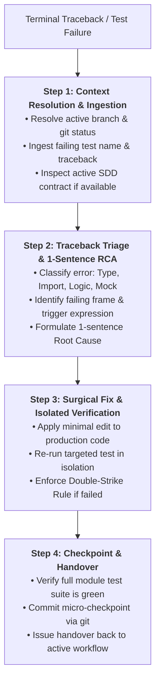

# Skill: Reactive Test Failure Diagnosis & Surgical Remediation (`/test-fix`)

Operates as the **Reactive Debugger** supporting the `/implement` TDD loop and `/refactor` feature refactoring. Ingests terminal error traces, isolates the defect mechanism in exactly one sentence, applies minimal surgical fixes strictly to production code, and maintains repository integrity via the Double-Strike Rule.

---

## Universal Operational Guardrails

- **Inviolability of Test Assertions:** Altering, deleting, or loosening test expectations or assertions to force a test pass is strictly prohibited. Edits belong exclusively in production code. (The only exception is fixing a proven syntactic typo in a newly authored unit test during Phase 2 Red phase).
- **Strict Surgical Scope:** Edit strictly the production lines directly responsible for the test failure. Refactoring surrounding code, modifying unrelated functions, or prematurely optimizing is forbidden.
- **Root Cause Isolation in 1 Sentence:** Formulate and state the exact root cause in one unambiguous sentence before making any code modifications.
- **Isolated Test Execution:** Always verify fixes by running the targeted failing test in isolation before running the wider suite.
- **Double-Strike Rule (Immediate Rollback):** At most two consecutive fix attempts are permitted. If the second attempt fails or causes regressions, stop immediately, execute `git reset --hard HEAD`, restore the clean baseline, and re-hypothesize from first principles.
- **Immediate Micro-Checkpoint:** As soon as tests return 100% green, record a local micro-checkpoint (`checkpoint(test-fix): surgical fix for [failure]`) to protect working progress.

---

## Execution Pipeline in 4 Steps



### Step 1: Context Resolution & Traceback Ingestion
1. Verify workspace status using non-destructive diagnostics:
   ```bash
   git -C <path> status --short && git -C <path> --no-pager branch --show-current
   ```
2. Ingest the user-provided terminal output, capturing:
   - Failing test identifier (`path/to/test_file.py::test_name`).
   - Exception class (e.g., `AssertionError`, `TypeError`, `KeyError`, `AttributeError`).
   - Exact failure message and bottom-most traceback frame pointing to source code.
3. If working within a feature lifecycle, retrieve relevant architectural contracts from the Obsidian Vault (`type: sdd` and `feature: [slug]`) via `@obsidian` to ensure the fix respects established domain boundaries.
4. **Detailed Reference:** Review [`./references/test-fix-protocol.md`](./references/test-fix-protocol.md).

### Step 2: Traceback Triage & Root Cause Isolation
1. Classify the defect using the Error Triage Matrix:
   - **Type Mismatch / Signature Error:** Incompatible types passed across boundaries or missing type conversion.
   - **Missing Import / Name Resolution:** Unresolved identifier or broken module import path.
   - **Logic / Calculation Defect:** Incorrect conditional branch, off-by-one index, or invalid return value calculation.
   - **Mock / Fixture Misconfiguration:** Missing mock attribute, mock return value mismatch, or leaky state in test fixture.
2. Isolate the root cause into **exactly one sentence** following [`./resources/diagnostic-report-template.md`](./resources/diagnostic-report-template.md):
   > **Root Cause:** `[Error Category]: [Component/Function] fails because [exact defect mechanism], resulting in [observed failure].`
3. Identify the precise file path and line numbers requiring modification.

### Step 3: Surgical Production Code Fix & Isolated Verification
1. Apply the minimal edit strictly to the identified production file. Keep the diff minimal and focused.
2. Preserve test code: Do not touch test assertions or weaken test thresholds.
3. Re-run the isolated failing test immediately in the terminal:
   ```bash
   python -m pytest path/to/test_file.py -k test_name -v
   ```
4. **Evaluate Result:**
   - **PASS (Green):** Proceed to Step 4.
   - **FAIL (Strike 1):** Analyze the new error output. Refine the surgical fix and test once more.
   - **FAIL (Strike 2 — Double-Strike Rule Triggered):** Immediately abort the attempt to avoid context poisoning. Execute local rollback:
     ```bash
     git reset --hard HEAD
     ```
     Report the rollback to the user, state why the hypothesis was invalid, and formulate a new approach.

### Step 4: Checkpoint & Handover
1. Execute the entire test module to guarantee zero side-effects or regressions:
   ```bash
   python -m pytest path/to/test_file.py -v
   ```
2. Commit the clean surgical fix as a local micro-checkpoint:
   ```bash
   git add path/to/modified_file.py
   git commit -m "checkpoint(test-fix): surgical fix for [concise failure description]"
   ```
3. Issue the standard phase handover back to the active workflow:
   > **[NEXT STEP]** *"Surgical fix applied and verified with 100% green tests! Resume active development by running `/implement` (if continuing TDD batches) or `/refactor` (if continuing feature refactoring)."*

---

## Bundled References & Concrete Examples

- **Pure Templates:**
  - [`resources/diagnostic-report-template.md`](./resources/diagnostic-report-template.md) — Standardized test failure diagnostic report with Executive Summary, Triage Matrix, 1-Sentence RCA, and Verification Plan.
- **Operational Guide:**
  - [`references/test-fix-protocol.md`](./references/test-fix-protocol.md) — Comprehensive operational protocol covering traceback triage, the 1-sentence RCA formula, surgical fix constraints, isolated test commands, and the Double-Strike recovery procedure.
- **Concrete Walkthrough:**
  - [`examples/test-fix-example.md`](./examples/test-fix-example.md) — Step-by-step diagnostic walkthrough resolving a real-world `TypeError` failure in a domain pricing service.
