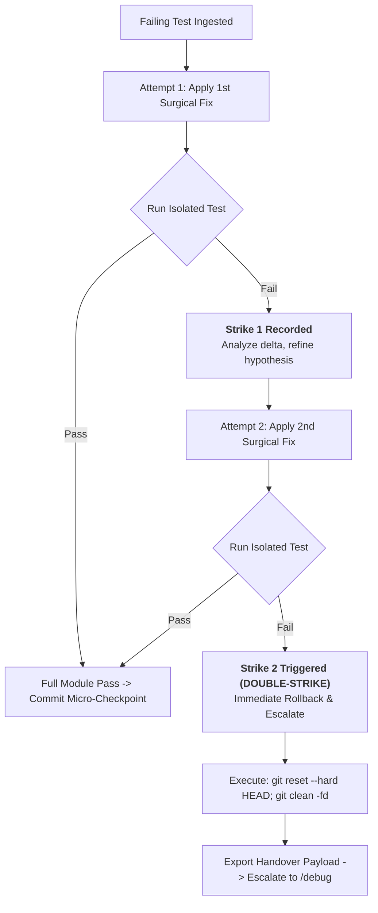

# Operational Protocol: Reactive Debugger & Surgical Test Fixing (`/test-fix`)

This operational protocol guides the systematic diagnosis, triage, surgical remediation, and fault-tolerant rollback of failing automated tests during the TDD implementation loop (`/implement`), feature refactoring (`/refactor`), and audit remediation (`/review`).

---

## 1. Traceback Triage Protocol

Automated test failures in Python environments provide structured stack traces. Triage must proceed **from bottom to top**:

```
Traceback (most recent call last):
  File "tests/unit/test_service.py", line 42, in test_process_payment   <-- 3. Test Caller Frame
    response = service.process_payment(order_id="ORD-100", amount=0)
  File "src/domain/payment_service.py", line 88, in process_payment    <-- 2. Internal Frame
    return self._gateway.charge(order_id, fee)
  File "src/domain/payment_service.py", line 112, in _calculate_fee    <-- 1. Point of Failure
    return amount * self.rate
TypeError: unsupported operand type(s) for *: 'NoneType' and 'float'   <-- 0. Exception & Message
```

### 1.1. Bottom-Up Ingestion Order
1. **Level 0 (Exception Class & Message):** Inspect the final line. Identifies the exact violation (e.g., `TypeError`, `KeyError`, `AssertionError`, `ZeroDivisionError`).
2. **Level 1 (Failing Frame):** Identify the bottom-most file and line within application code (`src/` or `app/`). Avoid third-party library frames unless investigating input parameter mismatches.
3. **Level 2 (Triggering Call Chain):** Trace the inputs passed from the caller frame into the failing frame to discover where invalid state originated.
4. **Level 3 (Test Assertion Context):** Review what the test was validating (Arrange inputs, Act invocation, Assert expectations).

### 1.2. Truncated Traceback Fallback
If the user provides an incomplete error log or truncated traceback that omits the bottom application frame:
- **Do not guess or speculate.**
- Execute the isolated test in the terminal with detailed short traceback flags:
  ```bash
  python -m pytest path/to/test_file.py -k test_name -vv --tb=short
  ```
- Use the refreshed terminal output to extract the exact frame and variables.

### 1.3. Failure Classification Matrix

| Category | Typical Exception | Primary Defect Source | Surgical Remedy |
| :--- | :--- | :--- | :--- |
| **Type Mismatch** | `TypeError`, `AttributeError` | None passed to arithmetic, missing attribute on dataclass, invalid type conversion. | Add default value, null-check guard, or explicit cast in production code. |
| **Logic / Calculation** | `AssertionError` | Boundary condition off-by-one, inverted boolean, missing discount tier. | Correct comparison operator, loop boundary, or calculation formula. |
| **Boundary / Contract** | `KeyError`, `IndexError` | Missing dictionary key, empty collection access, schema mismatch. | Use safe getter (`.get()`), validate required keys, check list bounds. |
| **State / Lifecycle** | `ValueError`, `RuntimeError` | Illegal state transition, uninitialized resource, expired token. | Enforce state machine validation or initialize component in constructor. |
| **Mock / Boundary Leak** | `unittest.mock.InvalidSpecError` | Missing mocked method, leaky fixture, incorrect mock return type. | Align mock specification with real interface; ensure `autospec=True`. |

---

## 2. The 1-Sentence Root Cause Isolation Formula

Before editing any code, the exact root cause must be synthesized into **exactly one sentence** adhering to the formula in [`../resources/diagnostic-report-template.md`](../resources/diagnostic-report-template.md):

$$\text{[Category]}: \text{[Target Function/Component]} \text{ fails because } \text{[exact defect mechanism]}, \text{ causing } \text{[observed failure]}.$$

### Valid Examples:
- *Type Mismatch:* `_calculate_fee` in `src/domain/payment_service.py` fails because `amount` is `None` when orders have zero upfront cost, causing a `TypeError` during multiplication.
- *Logic Defect:* `TierEvaluator.get_tier` in `src/domain/tiers.py` fails because the tier boundary uses `<=` instead of `<`, causing users with exactly 10,000 points to receive Silver instead of Gold.
- *Boundary Defect:* `UserRepository.get_by_email` in `src/infra/repo.py` fails because database row parsing accesses index `3` on a 3-element tuple, causing an `IndexError`.

### Invalid Examples (Vague or Speculative):
- ❌ *"Something is wrong with the payment calculation."* (Lacks exact mechanism and location).
- ❌ *"The test failed because the assertion expected True but got False."* (Describes the symptom, not the root cause).
- ❌ *"Maybe the database connection is slow."* (Speculation without traceback evidence).

---

## 3. Surgical Fix Principles (Zero Collateral Damage)

When applying the fix, follow these strict engineering constraints:
1. **Production Code Exclusivity:** Modify only the production file where the defect resides. Never modify test assertions or mock expectations to disguise production defects.
2. **Strict Test Inviolability Exception:** The *only* permitted modification to test files is correcting a proven syntactic typo or broken mock configuration authored in the active, uncommitted Red phase of `/implement`. The test must still enforce the exact BDD/SDD specification. Weakening assertions or lowering thresholds to make code pass is strictly forbidden.
3. **Minimal Diff Size:** Make the smallest possible change that makes the test pass cleanly. Do not introduce new abstractions, refactor surrounding functions, or add unrequested features.
4. **Preserve Public API Contracts:** Do not change method signatures, rename arguments, or alter return types if existing tests or callers depend on them.
5. **Clean Code & Type Annotations:** Ensure newly added lines include strict type hints and adhere to project linting rules.

---

## 4. Test Isolation & Re-execution Protocol

Never run the entire application or end-to-end test suite for the first verification step.

### 4.1. Single-Test Targeted Command
Execute only the failing test using the `-k` filter or exact node identifier:
```bash
# Pytest targeting exact test function
python -m pytest tests/unit/test_payment_service.py -k test_process_payment_zero_amount -v

# Pytest targeting exact line number
python -m pytest tests/unit/test_payment_service.py::TestPaymentService::test_process_payment_zero_amount -v
```

### 4.2. Module-Level Regression Check
Once the isolated test passes green, execute all tests in the containing module to ensure no regressions were introduced:
```bash
python -m pytest tests/unit/test_payment_service.py -v
```

---

## 5. Double-Strike Rule & Emergency Recovery Procedure

To prevent context window degradation and compounding regressions during debugging, adhere to the **Double-Strike Rule**:



### Protocol on Strike 2:
1. **Do Not Attempt a 3rd Consecutive Edit:** Context pollution and mental drift occur when layering fixes upon fixes.
2. **Immediate Rollback Execution:**
   ```bash
   git reset --hard HEAD
   git clean -fd
   ```
3. **Structured Escalation to `/debug`:** Explain why hypotheses 1 and 2 failed, report that the baseline is clean, and hand over to `/debug` with the following payload:
   ```text
   Double-Strike triggered in /test-fix. Workspace rolled back to clean HEAD.
   Handover to /debug:
   - Target Test Node: [path/to/test.py::test_name]
   - Observed Traceback: [Exception and bottom application frame]
   - Strike 1 (Falsified): [Mechanism 1] -> [Why it failed]
   - Strike 2 (Falsified): [Mechanism 2] -> [Why it failed]
   - Next Step: Initiate forensic investigation with probing tests via /debug.
   ```

---

## 6. Git Micro-Checkpoint & Handover Protocol

When the fix passes both isolated and module-level test runs:
1. Stage only the modified production files:
   ```bash
   git add src/domain/payment_service.py
   git commit -m "checkpoint(test-fix): handle zero amount in fee calculation"
   ```
2. Verify clean working tree:
   ```bash
   git status --short
   ```
3. Guide user to next workflow phase:
   - If in Phase 2: Resume `/implement` for the next batch.
   - If in Phase 3: Resume `/refactor` to continue code cleanup.
   - If resolving an audit finding: Resume `/review` to re-verify compliance.
